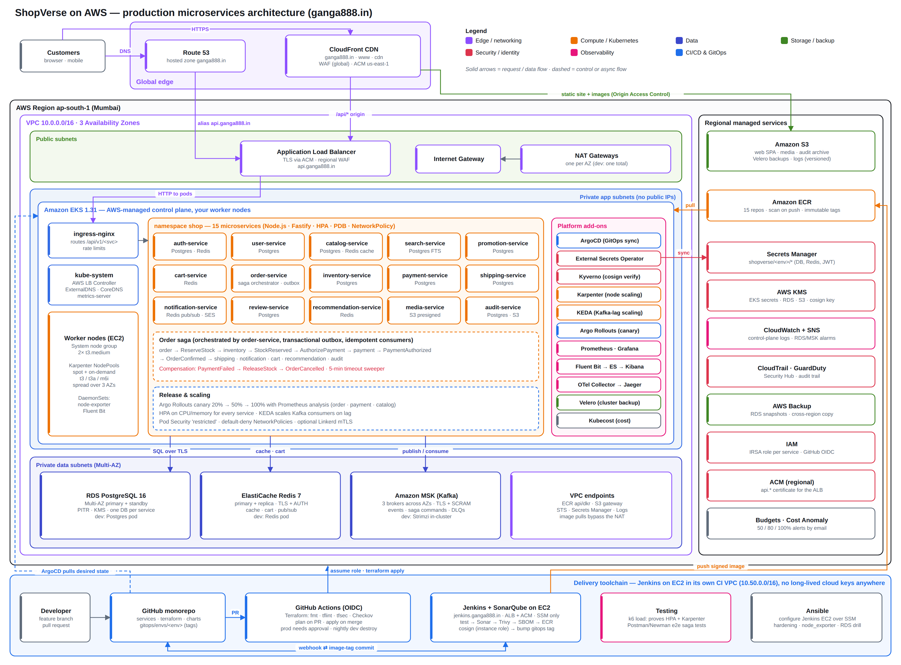

# ShopVerse — production microservices on AWS (ganga888.in)

ShopVerse is an e-commerce platform built as 15 Node.js/TypeScript microservices on Amazon EKS in `ap-south-1`.
Everything — AWS infrastructure, Kubernetes platform, services, pipelines, dashboards, policies and runbooks — is in this repo.



More diagrams: [CI/CD and GitOps](docs/diagrams/cicd-gitops.png) · [Order saga](docs/diagrams/saga.png).
Names, ports, topics and secret paths are fixed in [docs/CONTRACT.md](docs/CONTRACT.md).

## Repository layout

| Path | What it holds |
|---|---|
| `terraform/` | `bootstrap/` (state bucket), `global/` (Route 53, ECR, OIDC, KMS, CloudTrail, GuardDuty, budgets, SES), `ci/` (Jenkins EC2 host, ALB, HTTPS), `modules/` (vpc, eks, karpenter, irsa, rds, elasticache, msk, s3, cloudfront, waf-regional, acm-regional, secrets, observability, backup), `envs/{dev,staging,prod}` |
| `services/` | 15 services + `libs/common` (logging, metrics, tracing, Kafka, outbox, auth, health), `docker-compose.yml` for local runs |
| `web/` | Static storefront SPA deployed to S3 + CloudFront |
| `charts/microservice/` | One Helm chart for every service (Deployment or Argo Rollout, HPA/KEDA, PDB, NetworkPolicy, ExternalSecret, ServiceMonitor, alerts) |
| `gitops/` | ArgoCD app-of-apps per env, ApplicationSet for services, platform add-ons, per-env service values (image tags live here) |
| `ci/` | `Jenkinsfile` and the Jenkins + SonarQube stack that runs on EC2 (`terraform/ci`, configured by Ansible) |
| `.github/workflows/` | Terraform plan/apply (OIDC), promotion PRs, nightly dev destroy/recreate, web deploy, Newman e2e |
| `ansible/` | Configures the Jenkins EC2 host over SSM (hardening, Docker, Jenkins stack, node_exporter, CloudWatch agent) + ops runbooks |
| `observability/` | Grafana dashboards, Prometheus/SLO rules, Alertmanager config, Fluent Bit parsers |
| `security/` | Kyverno policies (cosign verify, limits, probes, registries), Checkov/tfsec/Trivy config |
| `tests/` | k6 load tests and the Postman/Newman end-to-end collection |
| `docs/` | Contract, diagrams, runbooks |

## Try it locally (no AWS needed)

```bash
cd services
docker compose up --build        # Postgres, Redis, Kafka, Jaeger, 15 services, nginx gateway on :8080
./scripts/e2e-smoke.sh           # register → browse → cart → checkout → order CONFIRMED / CANCELLED
```
Jaeger UI: http://localhost:16686. See [services/README.md](services/README.md).

## Go live on AWS

The full step-by-step walkthrough is in [docs/IMPLEMENTATION.md](docs/IMPLEMENTATION.md) (also as PDF). Summary:

1. **One-time bootstrap** — `terraform/bootstrap` with admin credentials (state bucket + lock table).
2. **Global** — `terraform/global`, then point the ganga888.in registrar NS records at the four name servers it outputs.
3. **GitHub** — set repo variables/secrets listed in [terraform/README.md](terraform/README.md); create GitHub environments `dev`, `staging`, `prod` (prod with required reviewers).
4. **Dev** — PR touching `terraform/envs/dev` → plan comment → merge → GitHub Actions applies.
5. **ArgoCD** — the morning workflow (or `docs/runbooks/nightly-destroy-and-recreate.md`) installs ArgoCD and applies `gitops/bootstrap/dev-root.yaml`; ArgoCD then syncs every add-on and service.
6. **Jenkins on EC2** — `terraform/ci` (set `admin_cidrs`), put the GitHub token in `shopverse/ci/jenkins`, run `ansible-playbook -i inventories/ci/hosts.yml playbooks/jenkins.yml`, open `https://jenkins.ganga888.in`. The first build pushes and signs all 15 images (via the instance role, no keys) and bumps the dev tags.
7. **Verify** — `newman-e2e.yml` against `https://api.dev.ganga888.in`, then `tests/k6/load.js` while watching HPA/Karpenter in Grafana.
8. **Staging / prod** — same Terraform flow (prod apply needs approval); promote images with `promote.yml`.

Before the first apply, replace the placeholders: account ID `111122223333`, `OWNER/shopverse` repo, and values marked `# tf-output:` in `gitops/` (fill them from `terraform output`).

## Cost safety

Dev is destroyed every evening at 20:00 IST and recreated at 08:00 IST on weekdays (`.github/workflows/nightly-dev.yml`).
`terraform destroy` in any env removes everything it created. Budgets alert at 50/80/100%.

## Runbooks

[DR restore](docs/runbooks/dr-restore.md) · [Incident response](docs/runbooks/incident-response.md) · [Rollback](docs/runbooks/rollback.md) ·
[Promotion](docs/runbooks/environment-promotion.md) · [Scaling](docs/runbooks/scaling.md) · [Secret rotation](docs/runbooks/secret-rotation.md) ·
[Nightly destroy](docs/runbooks/nightly-destroy-and-recreate.md) · [Cost governance](docs/runbooks/cost-governance.md) · [New service](docs/runbooks/onboarding-new-service.md)
